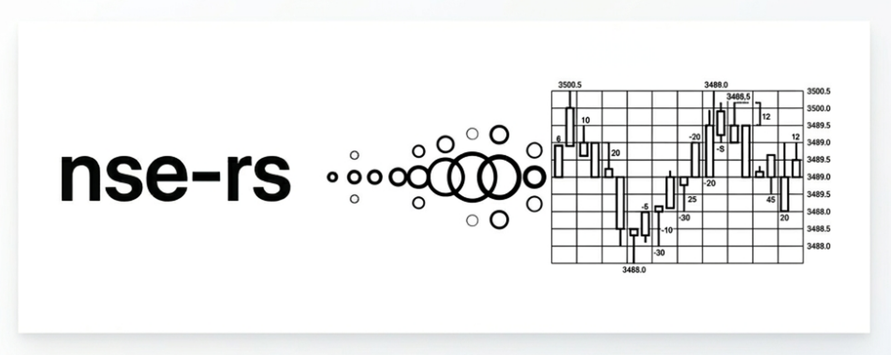

<p align="center">
  
</p>

<p align="center">
  <a href="https://github.com/ratan00/nse-rs"></a>
  
  
</p>

# nse-rs

An async Rust library for fetching live market data from the National Stock Exchange of India (NSE) — no API key or account required.

Provides live equity quotes, index quotes, structured option chains, futures, intraday & historical candles (stocks, indices, futures, options), continuous futures series, polling feed loops, and EOD bhavcopy archives — with built-in rate limiting so you don't get your IP blocked.

---

## Features

- **Live equity quotes** — flat `NseQuote` with LTP, OHLCV, change, volume
- **Live index quotes** — NIFTY 50, NIFTY BANK, INDIA VIX etc.; one or many indices per request
- **Structured option chain** — `OptionChain` grouped by expiry date → strike → CE/PE
- **Futures** — all contracts for a symbol filtered from derivatives
- **Continuous futures** — daily front-month series stitched across expiries (expiry / days-before / OI / volume roll; ratio or difference back-adjustment), back to 2010
- **Historical candles** — intraday at any whole-minute interval (built from NSE's one-minute bars on the 09:15 IST grid, last ~30 days) or D/W/M (25+ years) for stocks, indices, live futures and options, with corrected per-bar volume
- **Polling feed** — `poll_quote()`, `poll_index()` and `poll_indices()` loops with error backoff
- **Built-in rate limiting** — paced, concurrency-capped requests with client-wide cool-down when NSE pushes back
- **EOD bhavcopy** — equity and F&O archives parsed into typed structs
- **Script token cache** — symbol → charting token cached in memory; repeat candle calls cost one request
- **Auto session retry** — one shared cookie refresh on 403/decode failures, backoff on 429/5xx, disk-cached for 1 hour
- **Fails fast and says why** — live calls time out in 10 s, a moved NSE host is reported by name (`HostMoved`), bad intervals are rejected before any request
- **No OpenSSL** — uses `rustls` with bundled webpki roots; cross-compiles cleanly (incl. Android)

---

## Installation

```toml
[dependencies]
nse-rs = { git = "https://github.com/ratan00/nse-rs.git" }
tokio  = { version = "1", features = ["full"] }
chrono = "0.4"
```

---

## Quick Start

```rust
use nse_rs::NseClient;

#[tokio::main]
async fn main() -> anyhow::Result<()> {
    let client = NseClient::new();
    client.init_session().await?;

    // Flat live quote
    let quote = client.get_stock_quote("RELIANCE").await?;
    println!("{}: LTP ₹{:.2}  vol {}", quote.symbol, quote.ltp, quote.volume);

    // Index spot price
    let nifty = client.get_index_quote("NIFTY 50").await?;
    println!("NIFTY 50: {:.2}  ({:+.2}%)", nifty.last, nifty.change_pct);

    // Structured option chain
    let chain = client.get_option_chain("NIFTY").await?;
    for (expiry, rows) in &chain.expiries {
        println!("=== {} ===", expiry);
        for row in rows.iter().take(3) {
            println!("  {:>8.0}  CE {:.2}  PE {:.2}",
                row.strike, row.ce.ltp, row.pe.ltp);
        }
    }

    Ok(())
}
```

---

## API Reference

### `NseClient`

Create with `NseClient::new()`, then call `init_session().await?` before any data fetch.

#### Rate limiting

Every request (including session refreshes and archive downloads) goes through a client-wide limiter. Defaults: **3 requests/s, 4 in flight**. Tune with `NseConfig`:

```rust
use nse_rs::{NseClient, NseConfig};

let client = NseClient::with_config(NseConfig {
    requests_per_sec: 10.0,   // <= 0 disables pacing
    max_concurrent:   8,
    ..NseConfig::default()
});
```

NSE publishes no limit and tolerance varies by IP. Measure yours with `cargo run --example stress -- [max_rate] [requests_per_step]`.
If NSE still answers 403 after a fresh session, the client pauses all requests for 15 s instead of retrying.

#### Timeouts and retries

| Calls | Timeout | Retries (429 / 5xx / network) |
|---|---|---|
| Live: quotes, indices, derivatives / option chain, market status | `live_timeout`, default **10 s** | 1 |
| Everything else: history, holidays, futures history, archives | `timeout`, default **45 s** | 2 |

So a live call against an unreachable NSE fails in about 20 s instead of minutes; a poller simply asks again on its next tick. Both are `NseConfig` fields:

```rust
let client = NseClient::with_config(NseConfig {
    live_timeout: std::time::Duration::from_secs(5),
    ..NseConfig::default()
});
```

#### Live data

| Method | Returns | Description |
|---|---|---|
| `get_stock_quote(symbol)` | `NseQuote` | Flat live quote for an equity (e.g. `"SBIN"`) |
| `get_index_quote(index_name)` | `NseIndexQuote` | Spot for an index (e.g. `"NIFTY 50"`, `"NIFTY BANK"`) |
| `get_index_quotes(&[names])` | `Vec<NseIndexQuote>` | Several indices from one request |
| `get_all_indices()` | `Vec<NseIndexQuote>` | Every index NSE publishes, one request |
| `get_option_chain(symbol)` | `OptionChain` | All options grouped by expiry/strike with CE+PE |
| `get_futures(symbol)` | `Vec<DerivativeContract>` | All futures contracts |
| `get_option_contracts(symbol)` | `Vec<DerivativeContract>` | Raw option contracts (unstructured) |
| `get_derivatives_quote(symbol)` | `NextApiDerivativesResponse` | Full raw derivatives response |
| `get_market_status()` | `MarketStatusResponse` | Open / Closed / Pre-market |

#### Polling feed

```rust
use tokio::sync::mpsc;

let (tx, mut rx) = mpsc::channel(64);

// Spawn a polling loop — sends a NseQuote every 3 seconds
tokio::spawn(async move {
    client.poll_quote("INFY", 3_000, tx).await;
});

while let Some(q) = rx.recv().await {
    println!("{}: ₹{:.2}", q.symbol, q.ltp);
}
```

`poll_index("NIFTY 50", interval_ms, tx)` works the same way for indices. To follow several indices use `poll_indices(&["NIFTY 50", "NIFTY BANK"], interval_ms, tx)` — one request per tick instead of one per index.

The minimum interval is 500 ms. Slow responses never trigger catch-up bursts, and errors back off exponentially (up to 60 s). Loops stop automatically when the receiver is dropped.

#### Historical candles

```rust
use chrono::Utc;

let end   = Utc::now();
let start = end - chrono::Duration::days(5);

// 5-minute intraday candles (market hours only, auto-filtered)
let candles = client.get_historical_candles("SBIN", start, end, "5").await?;

// Daily candles going back years
let daily = client.get_historical_candles("NIFTY", start, end, "D").await?;

// Live futures and option contracts, and India VIX
let fut = client.get_historical_candles("NIFTY26OCTFUT",     start, end, "5").await?;
let opt = client.get_historical_candles("NIFTY26OCT22500CE", start, end, "5").await?; // monthly
let wk  = client.get_historical_candles("NIFTY26O1322250CE", start, end, "5").await?; // weekly, 13-Oct
let vix = client.get_historical_candles("INDIA VIX",         start, end, "5").await?;
```

Symbol formats:

| Instrument | Format | Example |
|---|---|---|
| Stock / index | NSE name | `"SBIN"`, `"NIFTY 50"`, `"NIFTY BANK"` |
| Future | `SYMBOL` + `YY` + `MON` + `FUT` | `NIFTY26OCTFUT`, `BANKNIFTY26NOVFUT` |
| Monthly option | `SYMBOL` + `YY` + `MON` + strike + `CE`/`PE` | `NIFTY26OCT22500CE` |
| Weekly option | `SYMBOL` + `YY` + month code + `DD` + strike + `CE`/`PE` | `NIFTY26O1322250CE` |

The weekly month code is `1`–`9` for Jan–Sep, then `O`, `N`, `D`. Only **currently listed** contracts are available — NSE drops expired contracts from the charting API (use [continuous futures](#continuous-futures) for history).

**Intervals:** minutes `"1"` to `"375"` (e.g. `"1"` `"3"` `"5"` `"15"` `"30"` `"60"`) or `"D"` `"W"` `"M"`. Anything else (`"1D"`, `"5m"`, `"d"`) is an error before any request is made; `Interval::parse` is public if you want to validate input yourself.

**How intraday bars are built:** NSE's own bars above one minute are unreliable (older days are stamped at each bar's last trade instead of its start, the day's total volume appears in more than one bar, and a 60-minute bar can hold several times the day's turnover). So every intraday request fetches NSE's **one-minute** bars and builds the requested interval from them on the **09:15 IST session grid**: a 5-minute day reads 09:15, 09:20 … 15:25, and a 60-minute day reads 09:15, 10:15 … 15:15. Bar `time` is the bucket start, in IST-shifted epoch milliseconds.

**How far back:** NSE keeps intraday bars for whole sessions from about the last 30 calendar days (`INTRADAY_HISTORY_DAYS`). A window that ends before that is an error; one that starts before it returns the sessions NSE still has. Daily, weekly and monthly go back decades.

Intraday candles are automatically filtered to 09:15–15:30 IST, so pre-open and post-close trades are excluded.

**Volume by instrument:**
- **Stocks, futures, options:** real per-bar volume, in units (shares / quantity, not lots).
- **Indices (NIFTY 50, NIFTY BANK, …):** intraday volume is always **0** — an index isn't traded. Daily candles do carry volume. For an intraday volume proxy use the near-month future.
- **INDIA VIX:** volume 0, and charting prices come back ×100 (`1412.5` = 14.125).

**Stock intraday volume:** NSE's one-minute data puts (roughly) the whole day's volume in one row near the close (15:28 or 15:29). The library finds that row by size and replaces its volume with the day total minus the day's other bars, clamped at 0, so treat the closing minute's volume as an estimate. A full day's bars sum to within a few percent of the daily candle's volume (the difference is pre-open and post-close trading).

**Known gaps in NSE's data:** NSE publishes no one-minute rows for **15:16–15:19** on any stock, and older days miss a few more closing minutes, so the bars covering 15:15–15:25 are partial. Use a broker's history if you need the close complete.

#### Continuous futures

```rust
use chrono::NaiveDate;
use nse_rs::{Adjustment, ContinuousOptions, RollRule};

let from = NaiveDate::from_ymd_opt(2025, 1, 1).unwrap();
let to   = NaiveDate::from_ymd_opt(2026, 10, 8).unwrap();

let series = client.get_continuous_futures("NIFTY", from, to, ContinuousOptions {
    roll:       RollRule::OpenInterest,   // or Expiry, DaysBeforeExpiry(n), Volume
    adjustment: Adjustment::Ratio,        // or Difference, None
}).await?;

for b in &series.bars {
    println!("{} {:.2} (raw {:.2}) contract {}", b.date, b.close, b.raw_close, b.contract);
}
for r in &series.rolls {
    println!("roll {}: {} → {} gap {:+.2}", r.date, r.from, r.to, r.to_close - r.from_close);
}
```

- **Roll rules:** `Expiry` holds each contract through expiry day. `DaysBeforeExpiry(n)` switches once fewer than `n` trading days remain. `OpenInterest` and `Volume` switch the first day the next contract overtakes the current one.
- **Adjustment:** older segments are shifted so the latest segment keeps real prices. `Ratio` preserves % returns; `Difference` preserves point moves. `raw_close`, `volume` and `oi` are always the held contract's own values.
- **Raw contracts:** `get_futures_daily_history(symbol, from, to)` returns every contract's daily OHLC / settle / volume / OI (volume and OI in units; divide by `lot_size` for contracts).
- **Cost:** data comes from NSE's `foCPV` endpoint in 20-day windows (NSE caps each response at 70 rows), about 13 requests per year of history.
- **Daily only:** NSE serves no intraday candles for expired contracts, so intraday series can't be stitched.

Run it: `cargo run --example continuous_futures -- NIFTY 2025-01-01 2026-10-08`

#### EOD archives

```rust
use chrono::NaiveDate;

let date = NaiveDate::from_ymd_opt(2025, 6, 20).unwrap();

// Equity bhavcopy
let records = client.fetch_full_bhavcopy(date).await?;

// All actively trading symbol names for a date
let symbols = client.fetch_symbol_list(date).await?;

// F&O bhavcopy — typed structs, both pre/post July-2024 formats
let fo = client.fetch_fo_bhavcopy(date).await?;
for rec in fo.iter().take(5) {
    println!("{} {} {} @ {:.2}  OI {}", rec.symbol, rec.expiry, rec.option_type, rec.strike, rec.oi);
}
```

---

## Key Types

### `NseQuote`
```rust
pub struct NseQuote {
    pub symbol:       String,
    pub company_name: String,
    pub ltp:          f64,
    pub open:         f64,
    pub high:         f64,
    pub low:          f64,
    pub prev_close:   f64,
    pub close:        f64,
    pub change:       f64,
    pub change_pct:   f64,
    pub volume:       f64,
    pub traded_value: f64,
    pub year_high:    f64,
    pub year_low:     f64,
    pub last_update:  String,
}
```

### `OptionChain`
```rust
pub struct OptionChain {
    pub symbol:   String,
    // expiry date string → rows sorted by strike ascending
    pub expiries: BTreeMap<String, Vec<OptionChainRow>>,
}

pub struct OptionChainRow {
    pub strike: f64,
    pub ce:     OptionSide,
    pub pe:     OptionSide,
}

pub struct OptionSide {
    pub ltp:          f64,
    pub oi:           f64,
    pub change_in_oi: f64,
    pub volume:       f64,
}
```

### `ContinuousFutures`
```rust
pub struct ContinuousFutures {
    pub symbol: String,
    pub bars:   Vec<ContinuousBar>,
    pub rolls:  Vec<RollEvent>,
}

pub struct ContinuousBar {
    pub date:      NaiveDate,
    pub open:      f64,   // adjusted
    pub high:      f64,
    pub low:       f64,
    pub close:     f64,
    pub settle:    f64,
    pub volume:    f64,   // held contract's own value, units
    pub oi:        f64,   // held contract's own value, units
    pub contract:  NaiveDate, // expiry of the held contract
    pub raw_close: f64,   // unadjusted close
}

pub struct RollEvent {
    pub date:       NaiveDate, // first day on the new contract
    pub from:       NaiveDate,
    pub to:         NaiveDate,
    pub from_close: f64,
    pub to_close:   f64,
}
```

### `FoBhavRecord`
```rust
pub struct FoBhavRecord {
    pub symbol:          String,
    pub expiry:          String,
    pub instrument_type: String, // "FUTIDX", "OPTIDX", "FUTSTK", "OPTSTK"
    pub option_type:     String, // "CE", "PE", or "-"
    pub strike:          f64,
    pub open:            f64,
    pub high:            f64,
    pub low:             f64,
    pub close:           f64,
    pub settle_price:    f64,
    pub contracts:       u64,
    pub oi:              u64,
    pub change_in_oi:    i64,
}
```

---

## Session & Cookie Management

NSE's web APIs require browser cookies (`nsit`, `nseappid`, etc.) obtained by hitting their landing page. `nse-rs` handles this transparently:

1. **Disk cache** at `~/.cache/nse-rs/session.json` — reused for up to 1 hour across process restarts. Only a session that actually has cookies is written or read
2. **Validated warm-up** — a refresh loads a quote page that must answer 2xx and set at least one cookie; if NSE refuses it with a 403 (Akamai throttling the IP), the client also pauses for 15 s
3. **Auto-refresh** — if a request returns a 401/403 or a decode error, the session is refreshed once (shared by every task that hit the same failure) and the request retried. 429, 5xx and network errors are retried with jittered backoff (see [timeouts and retries](#timeouts-and-retries)), without touching the session
4. **Force refresh** — call `client.force_refresh_session().await?` to discard and re-fetch

---

## Errors worth handling

| Error | Means | What to do |
|---|---|---|
| `HostMoved { from, to }` (in the error chain) | NSE redirected a request to another host: it has moved domains (as `nseindia.com` → `nseindia.in` did in Nov 2026). Never retried | Update the hosts in `src/hosts.rs` (one file) |
| `unsupported interval '…'` | Bad `interval` argument | Use minutes (`"1"`–`"375"`) or `"D"` / `"W"` / `"M"` |
| `NSE keeps about 30 days of intraday history` | The whole window is older than NSE's intraday horizon | Use `"D"`, or a broker's history |
| `NSE rejected the request even with a fresh session` | Still 403 after refreshing: IP throttled or blocked | Back off; see Cloud & Geo Restrictions below |
| `no answer from NSE within …` | A live call timed out (after its one retry) | Usually the network; a poller retries on its own |

```rust
if let Err(e) = client.get_stock_quote("SBIN").await {
    if let Some(moved) = e.chain().find_map(|c| c.downcast_ref::<nse_rs::HostMoved>()) {
        eprintln!("NSE moved {} → {}", moved.from, moved.to);
    }
}
```

---

## ⚠️ Cloud & Geo Restrictions

`www.nseindia.in` and `charting.nseindia.in` (live quotes, option chains, charting) enforce strict firewall rules. (NSE moved both from `.com` to `.in` in November 2026; every host the library uses lives in `src/hosts.rs`.)

- **Geo-blocking** — requests from IPs outside India are frequently rejected with 403 or TCP resets
- **Cloud IP blocking** — AWS, GCP, Azure, DigitalOcean and similar data-centre ranges are blocked even within India

**Run from a residential Indian internet connection.** Residential proxies are an alternative. Blocking isn't uniform — some cloud IPs get through to the JSON APIs even when the homepage returns 403 — so test from your actual host (`cargo run --example stress`).

The archive domain `nsearchives.nseindia.com` (bhavcopy downloads) does **not** have these restrictions and works globally.

---

## Examples

```bash
cargo run --example demo                  # quotes, derivatives, option chain, candles, archives
cargo run --example continuous_futures -- NIFTY 2025-01-01 2026-10-08
cargo run --example stress -- 20 40       # find your IP's request-rate ceiling
cargo run --example fetch_symbols         # all trading symbols from the bhavcopy
cargo run --example test_market_status
```

---

Credits: inspired by Python's `jugaad-data` and `nsemine` — rewritten in Rust for type safety, zero-cost abstractions, and no runtime overhead.

## License

MIT
